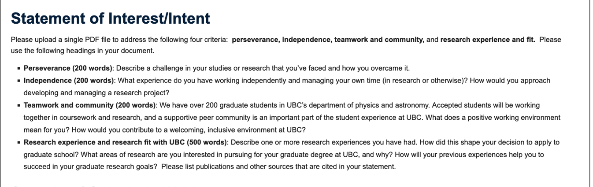

# Statement of Interest

## Perseverance

One of the most challenging parts of my research on dark-matter halos was learning to distinguish a meaningful physical result from one that depended too heavily on modelling assumptions. I studied the concentration–mass relation using rotation curves from 620 MaNGA disk galaxies. Although my initial analysis suggested a modest negative relationship, I was concerned that the result might be influenced by parameter degeneracies and assumptions about galaxy inclination.

Rather than treating the initial result as conclusive, I examined the posterior distributions, checked sampling diagnostics, and conducted prior-sensitivity analyses. I also tested subsamples while allowing for inclination uncertainty. These tests broadened the constraints and made me reconsider how strongly I could interpret the inferred relationship. The additional analysis did not produce a simpler conclusion, but it gave me a more defensible understanding of the model's limitations.

This experience changed how I approach difficult research problems. I learned that progress does not always mean obtaining a stronger result; sometimes it means identifying why a result is uncertain and determining what the available evidence can support. Completing the analysis and bringing the project to a first-author manuscript required sustained effort, especially when the conclusions became less straightforward. I now see careful validation and a willingness to revise my interpretation as essential parts of doing reliable physics.

## Independence

My MaNGA project has been my most substantial experience of independent research. I developed a Python and PyMC pipeline to decompose galaxy rotation curves, estimate halo parameters using Markov chain Monte Carlo, and connect individual-galaxy posteriors to population-level inference through prior-corrected importance sampling. This required me to translate a physical question into a statistical framework, implement the numerical analysis, and decide which diagnostic tests were necessary to assess the results.

I managed the work by breaking the larger question into smaller tasks, including model implementation, convergence checks, sensitivity analyses, and interpretation. When an analysis produced unexpected results, I returned to the assumptions and intermediate outputs rather than immediately changing the model to obtain a preferred answer. This approach helped me keep the project moving while maintaining a clear record of what each test could establish.

For a graduate research project, I would begin by clarifying the physical question and reviewing the relevant literature with my supervisor. I would then establish a manageable baseline model, define validation criteria, and organize the work into milestones. Regular discussions would help me identify conceptual problems early, while maintaining reproducible code and documenting decisions would support efficient progress. I value independence not as working in isolation, but as taking responsibility for the work while knowing when to seek feedback.

## Teamwork and community

My ongoing Higgs project with Professor Mario Campanelli at UCL requires explaining analysis choices, discussing validation, and responding to feedback as the research develops.

To me, a positive working environment is one in which people can ask questions without embarrassment, share incomplete ideas, and disagree about methods without making disagreements personal. Research often involves uncertainty, and a group benefits when its members feel comfortable pointing out potential weaknesses or asking for help. Such an environment encourages people to learn from one another rather than feel pressure to appear certain.

At UBC, I would contribute by being a considerate and engaged colleague: sharing useful computational approaches, discussing coursework and research problems, and offering constructive feedback when appropriate. I would also make an effort to include students with different levels of experience and backgrounds in conversations. I know that people develop expertise at different rates and bring different strengths to a research group. I would welcome opportunities to learn from peers in astrophysics, particle physics, and other areas, while contributing my own experience in Python-based modelling and statistical analysis. I hope to be part of a community where collaboration makes both the research and the graduate experience stronger.

## Research experience and research fit with UBC

I am completing an Honours Bachelor of Science in the Physics Specialist program at the University of Toronto and expect to graduate in June 2027. My research on dark-matter halos and simulated Higgs events has drawn me toward computational physics and statistical inference, particularly the question of how reliably physical parameters can be inferred from data.

In 2025–2026, I independently investigated the concentration–mass relation of dark-matter halos using 620 selected MaNGA disk galaxies. I built a rotation-curve mass-decomposition pipeline in Python and PyMC, using Markov chain Monte Carlo to preserve correlated uncertainties in halo mass and concentration. I then applied prior-corrected importance sampling to connect individual-galaxy posteriors with population-level inference. Prior-sensitivity analyses, sampling diagnostics, and inclination tests helped me assess the robustness of the results. The selected galaxies showed a modest negative slope under fixed photometric inclinations, but subsample tests allowing for inclination uncertainty produced broader constraints. This project taught me to treat modelling assumptions as part of the scientific question rather than as technical details. A first-author manuscript is complete but has not yet been submitted.

Since May 2026, I have been working remotely with Professor Mario Campanelli at UCL on neural-network selection of simulated Higgs four-lepton events. Using public ATLAS samples, I construct kinematic inputs and compare MLP classifiers, separating training, validation and evaluation. I examine expected yields and mass distributions and use profile-likelihood analysis and bootstrap resampling to study statistical uncertainty. The project is ongoing.

These projects have shaped my decision to pursue graduate study. I want to develop a stronger understanding of the physical models underlying an analysis, as well as the numerical and statistical methods used to test them. UBC is appealing because its research spans astrophysics and particle physics, both of which connect directly to my experience and interests.

I am particularly interested in Professor Ludovic Van Waerbeke’s research on gravitational lensing, dark matter, and structure formation. I would like to understand how lensing observations constrain mass distributions and how assumptions about halo structure affect those constraints. My experience with correlated posteriors and sensitivity analyses would provide a useful starting point for exploring these questions. I would also be interested in studying mass recovery in simulated lensing data under alternative halo models.

Professor Alison Lister’s ATLAS research also interests me. My ongoing work on event selection and statistical analysis provides a starting point for learning how collider searches are designed and validated. Under supervision, I would like to develop this experience while learning the experimental context.

I would be glad to pursue either direction and would work with my supervisor to identify a focused and feasible thesis question. My current coursework in computational physics, high-energy physics, and time-series analysis, alongside my training in theoretical physics and laboratory work, provides a foundation for this next step. After the MSc, I intend to pursue doctoral research in particle physics or astrophysics. At UBC, I hope to become a more independent researcher who can connect physical reasoning, computational modelling, and careful statistical inference.
